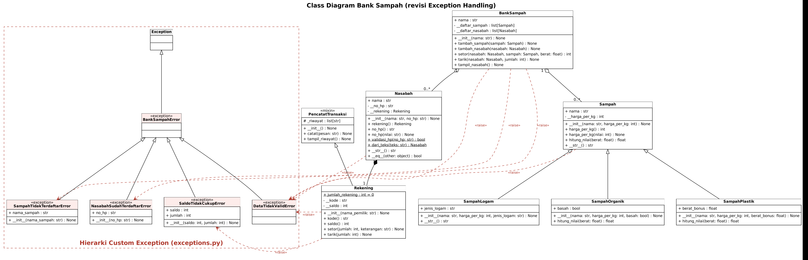

# Bank Sampah – Exception Handling

Pengembangan proyek UTS Pemrograman Berorientasi Objek (SI23C0702) dengan menambahkan *exception handling*.
Studi kasus: **No. 9 – Bank Sampah**. Kelas: Sistem Informasi PAGI1. Dosen: I Putu Buda Suyasa, S.Pd., M.Kom.

## Anggota Kelompok

| No | Nama | NIM | Kontribusi |
|---|---|---|---|
| 1 | Rama | 2501010025 | Repository, versi UTS awal, `exceptions.py`, README |
| 2 | Ken | 2501010034 | `models.py` (setter dan method dengan `raise`) |
| 3 | Gaga | 2501010013 | `main.py` (try-except-else-finally), revisi class diagram |

## Deskripsi Sistem

Petugas bank sampah mendaftarkan nasabah (nama dan nomor HP). Setiap nasabah otomatis memiliki satu rekening.
Nasabah menyetor sampah organik, plastik, atau logam; nilai setoran dihitung dari berat dan harga per kg lalu ditambahkan ke saldo.
Nasabah dapat menarik saldo, dan setiap transaksi dicatat dalam riwayat.

## Aturan Bisnis

| No | Aturan bisnis | Dicek di | Exception yang dilempar |
|---|---|---|---|
| 1 | Harga per kg harus berupa angka dan lebih dari 0 | setter `Sampah.harga_per_kg` | `DataTidakValidError` |
| 2 | Nomor HP hanya berisi angka dan diawali "08"; teks pendaftaran harus berformat `nama;no_hp` | setter `Nasabah.no_hp`, `Nasabah.dari_teks()` | `DataTidakValidError` |
| 3 | Berat setoran harus lebih dari 0 | `BankSampah.setor()` | `DataTidakValidError` |
| 4 | Jumlah penarikan harus lebih dari 0 | `Rekening.tarik()` | `DataTidakValidError` |
| 5 | Penarikan tidak boleh melebihi saldo | `Rekening.tarik()` | `SaldoTidakCukupError` |
| 6 | Satu nomor HP hanya boleh terdaftar satu kali | `BankSampah.tambah_nasabah()` | `NasabahSudahTerdaftarError` |
| 7 | Sampah yang disetor harus terdaftar di bank sampah | `BankSampah.setor()` | `SampahTidakTerdaftarError` |

Catatan: pada versi UTS, aturan 3 dan 4 belum dicek. Akibatnya `tarik(-5000)` justru **menambah** saldo dan setoran dengan berat negatif **mengurangi** saldo. Kedua celah ini ditutup pada versi ini.

## Hierarki Custom Exception

```
Exception
└── BankSampahError                  (base exception)
    ├── DataTidakValidError          data tidak valid (harga, no HP, berat, jumlah, format teks)
    ├── SaldoTidakCukupError         penarikan melebihi saldo
    ├── NasabahSudahTerdaftarError   nomor HP sudah terdaftar
    └── SampahTidakTerdaftarError    jenis sampah tidak diterima bank
```

Semua exception dapat ditangkap sekaligus dengan `except BankSampahError`, atau satu per satu sesuai jenis kesalahannya.

## Class Diagram



Keterangan: kelas berwarna merah muda adalah kelas exception. Garis putus-putus merah «raise» menunjukkan kelas yang melempar exception tersebut.
Segitiga kosong = inheritance, belah ketupat hitam = composition, belah ketupat putih = aggregation.

## Struktur Repository

```
.
├── README.md
├── exceptions.py          # hierarki custom exception
├── models.py              # kelas domain (Sampah, Rekening, Nasabah, BankSampah, ...)
├── main.py                # program utama dengan try-except-else-finally
└── docs/
    └── class_diagram.png  # class diagram revisi
```

## Cara Menjalankan

```bash
python main.py
```

## Contoh Output

```
== Membuat jenis sampah dengan harga tidak valid ==
  [GAGAL] Harga per kg harus lebih dari 0, diterima: -500
  Selesai membuat jenis sampah

== Pendaftaran nasabah ==
  [OK] Budi terdaftar, kode rekening BUD001
  Selesai memproses pendaftaran Budi
  [OK] Sari terdaftar, kode rekening SAR002
  Selesai memproses pendaftaran Sari
  [GAGAL] Nasabah dengan No HP 081234567890 sudah terdaftar
  Selesai memproses pendaftaran Budi Palsu
  [GAGAL] Data tidak valid: No HP tidak valid: 12345
  Selesai memproses pendaftaran Andi

== Setoran sampah ==
  [OK] Setor Botol Plastik 5 kg = Rp16500
  Saldo Budi: Rp16500
  [OK] Setor Kaleng 1.5 kg = Rp12000
  Saldo Budi: Rp28500
  [OK] Setor Sayur Basah 3 kg = Rp2400
  Saldo Sari: Rp2400
  [GAGAL] Data tidak valid: Berat setoran harus lebih dari 0, diterima: -2
  Saldo Sari: Rp2400
  [GAGAL] Sampah 'Kardus' tidak terdaftar di bank sampah
  Saldo Sari: Rp2400

== Penarikan saldo ==
  [OK] Tarik Rp10000
  Saldo Budi: Rp18500
  [GAGAL] Saldo tidak cukup (saldo Rp2400, ditarik Rp5000)
  Saldo Sari: Rp2400
  [GAGAL] Data tidak valid: Jumlah penarikan harus lebih dari 0, diterima: -5000
  Saldo Budi: Rp18500

== Daftar nasabah ==
Budi | BUD001 | Saldo Rp18500
Sari | SAR002 | Saldo Rp2400
Riwayat BUD001
  Setor Botol Plastik 5 kg +Rp16500
  Setor Kaleng 1.5 kg +Rp12000
  Tarik -Rp10000

Program Bank Sampah selesai.
```

## Penjelasan Blok try-except-else-finally

- `try`: menjalankan operasi yang mungkin gagal, misalnya `bank.setor(...)`.
- `except`: menangkap exception tertentu, misalnya `DataTidakValidError`, lalu menampilkan pesan tanpa menghentikan program.
- `else`: hanya dijalankan jika `try` berhasil, misalnya untuk mencetak "[OK]".
- `finally`: selalu dijalankan, berhasil atau gagal, misalnya untuk mencetak saldo terakhir.
